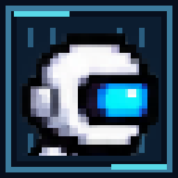
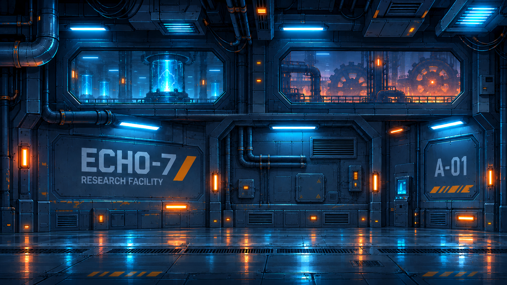
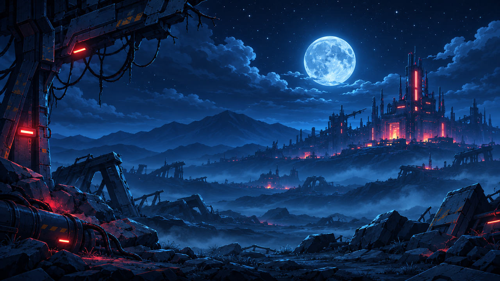

<p align="center">
  
</p>

<h1 align="center">ECHO-7</h1>

<p align="center">
  <strong>A 2D puzzle-platformer prototype built with Python and Pygame-ce.</strong><br>
  Explore a mysterious abandoned facility, restore its systems, and find your way to the surface.
</p>

<p align="center">
  
  
  
  
  
</p>

---

## About the project

**ECHO-7** is a single-player, non-combat puzzle platformer set inside an abandoned technological facility. You control a small robot and advance by exploring interconnected chambers, using movement abilities, interacting with machinery, and solving environmental puzzles.

The project combines precise platforming with switches, cargo crates, power-routing systems, conveyors, hazards, and chapter-specific challenges. It is a **work-in-progress prototype**, built as a personal Python game-development project rather than a finished commercial release.

> **Current scope:** 80 level definitions across eight chapters, a restored classic robot design with an expanded animation system, chapter-specific audiovisual presentation, checkpoint/progress handling, and desktop menus/settings. Level files have been subjected to static checks, but the entire campaign has **not** been confirmed through a complete hands-on playthrough.

## Highlights

- **Puzzle-first gameplay:** Progress through environmental logic and movement challenges, without combat.
- **80 chambers in eight chapters:** Different facility areas introduce changing visual themes, mechanics, and puzzle combinations.
- **Expressive robot movement:** Walk, run, jump, crouch, crouch-walk, wall-slide, wall-jump, dash, climb, and push cargo where supported by the level.
- **Expanded character animations:** 78 individual player sprite frames across 17 animation states, including dedicated crate-pushing and strain poses.
- **Interactive machinery:** Work with switches, relays, generators, valves, mirrors, pressure plates, conveyors, moving platforms, and other room-specific devices.
- **Atmosphere and sound:** Chapter-specific music with quieter and rhythmic layers, sound effects, and a separate finale cue.
- **Guidance without hand-holding:** KIP dialogue and optional puzzle hints accompany the exploration.
- **Desktop quality-of-life features:** Main menu, chapter/level selection, settings, key bindings, volume controls, checkpoints, saves, and restart options.

## Visual identity

The player is a small robot with a **rounded white helmet and cyan visor**. Its sprite set includes dedicated animations for walking, crouch-walking, jumping, falling, landing, climbing, and interacting with crates.

The repository also contains concept/reference art and assets for the different chapters. Some backgrounds are rendered procedurally by the game; the reference images below **are artwork previews, not screenshots of live gameplay**.

| Chapter 1 — Awakening | Chapter 8 — Surface Breach |
|:---:|:---:|
|  |  |

## The eight chapters

| Chapter | Levels | Focus |
|:---|:---:|:---|
| **01 — Awakening** | 01–10 | Learning the facility, cargo handling, early systems, and movement |
| **02 — Mechanical Depths** | 11–20 | Conveyors, counterweights, machinery, and industrial traversal |
| **03 — Power Grid** | 21–30 | Electrical routing, generators, relays, and freight puzzles |
| **04 — Optical Works** | 31–40 | Lasers, mirrors, observation areas, and security systems |
| **05 — Flood Control** | 41–50 | Water, air currents, valves, and cargo coordination |
| **06 — Furnace** | 51–60 | Crushers, heavy machinery, and unstable platforms |
| **07 — Broken Spire** | 61–70 | Precision movement, changing supports, and power management |
| **08 — Surface Breach** | 71–80 | Multi-stage mechanisms, final routes, and the escape sequence |

## Getting started

### Requirements

- **Python 3.11 or newer** (Python 3.12+ is a good choice).
- A desktop environment capable of running **Pygame-ce**.
- The **complete repository**, including its `data/` directory, levels, sprites, and soundtracks.

The sole required Python package for normal gameplay is specified in [`requirements.txt`](requirements.txt): `pygame-ce>=2.5.0`. Extra authoring tools may have additional dependencies.

### Linux (Ubuntu / Debian)

Open a terminal in the project folder (the one containing `main.py`):

```bash
sudo apt update
sudo apt install -y python3 python3-venv python3-pip

python3 -m venv .venv
source .venv/bin/activate
python -m pip install --upgrade pip
python -m pip install -r requirements.txt

python main.py
```

Alternatively, the bundled launcher creates a virtual environment and installs the runtime dependency when necessary:

```bash
bash launch_linux.sh
```

**For subsequent launches:**

```bash
cd /path/to/ECHO-7
bash launch_linux.sh
```

### Windows

From PowerShell, inside the project directory:

```powershell
py -m venv .venv
.\.venv\Scripts\python.exe -m pip install -r requirements.txt
.\.venv\Scripts\python.exe main.py
```

> Do not run the game from inside a ZIP preview. Extract the complete project first. If you move the project between machines, **recreate `.venv`** rather than copying the old environment.

## Default controls

| Action | Keyboard |
|:---|:---|
| Move left / right | `A` / `D` or arrow keys |
| Jump | `Space`, `W`, or `↑` |
| Sprint | `Shift` |
| Crouch | `S` or `↓` while grounded |
| Interact with machinery / KIP | `E` |
| Advance dialogue | `E` or `Space` |
| Directional dash (when unlocked) | `X` + movement direction |
| Wall slide / wall jump (when unlocked) | Move toward a wall while airborne / `Space` |
| Climb a ladder | `W` / `S` or `↑` / `↓` |
| Push a crate | Walk into its side |
| Drop through a one-way platform | Hold `↓` + `Space` |
| Show / expand a hint | `H` |
| Retry checkpoint | `R` |
| Pause / resume | `Esc` |

Some abilities become available later in the campaign. Controls and other preferences can also be adjusted in the settings menu.

## Progress and saves

Use **New Game** to start from the beginning or **Continue** to resume a saved campaign. Chapter and level selection are available from the menu.

Local progress is stored in `data/save_data.json`. If you publish your own working copy, review this file before committing: it may contain local play progress or settings that do not belong in the repository. Back it up separately if you want to preserve your progress.

## Project structure

```text
ECHO-7/
├── main.py                 # Entry point, asset checks, level validation
├── launch_linux.sh         # Linux launcher and environment bootstrap
├── requirements.txt        # Runtime dependency (pygame-ce)
├── requirements-dev.txt    # Additional development dependencies
├── src/
│   ├── core/               # Main game loop, settings, saves
│   ├── entities/           # Player, NPC behavior, game objects
│   ├── levels/             # Level loading and runtime management
│   ├── puzzles/            # Puzzle state and interactive mechanisms
│   ├── systems/            # Audio and supporting systems
│   ├── ui/                 # Menus, settings, interface components
│   ├── visuals/            # Rendering, sprites, animations
│   └── tests/              # Automated tests
├── data/
│   ├── levels/             # 80 JSON level definitions
│   ├── art/                # Character, environment and UI artwork
│   └── music/              # Chapter music, finale tracks
├── tools/                  # Validation, build and authoring utilities
└── docs/                   # Technical notes, previews and QA documents
```

## Validation and troubleshooting

Run these from the project root after installing the runtime dependency:

```bash
python main.py --check-assets  # Verify required artwork, audio, and 80 levels
python main.py --validate      # Validate the level definitions
```

To run the bundled unit tests:

```bash
python -m unittest discover -s src/tests
```

If the game unexpectedly closes, inspect `logs/last_crash.log` if it was created, and run `python main.py` from a terminal to see the traceback.

**Testing status:** Successful syntax, asset, and offline level checks do **not** prove that every puzzle is solvable or that every graphical and audio interaction works correctly. Full interactive testing—especially late-game rooms, scene transitions, and the finale—remains part of development.

## Development notes

The game is built in **Python**, uses **Pygame-ce** for its desktop loop, graphics, input, and sound, and stores level configurations in **JSON**. Gameplay systems and rendering are split into modules so levels, puzzles, artwork, and audio can evolve independently.

The `tools/` directory contains scripts for generating or inspecting music, backgrounds, sprites, and levels. These are **not** necessary for normal gameplay. Before rerunning old character-generation scripts, check their output targets: older tools may overwrite the expanded classic-robot sprites currently in `data/art/player/`.

### Areas for further improvement

- Playtest and refine difficulty, clarity, and solvability across the full 80-level campaign.
- Polish transitions, animations, performance, and chapter-specific visual effects.
- Expand user documentation, capture genuine gameplay screenshots, and improve distribution/packaging.

## Credits and licensing

ECHO-7 is a personal game-development project. Its repository contains game code, authored/generated artwork, music assets, and development tools. See [`MUSIC_CREDITS.md`](MUSIC_CREDITS.md) for the audio-production notes included with the project.

**License:** Consult the repository's [`LICENSE`](LICENSE) file once one has been added. If you choose the **MIT License**, include its complete text in a root-level `LICENSE` file with the correct copyright year and owner. Confirm that all code and assets you intend to license or redistribute are yours or are covered by compatible permissions; software, images, fonts, and music may have different rights.

---

<p align="center"><strong>ECHO-7</strong> — Explore. Experiment. Find a way out.</p>
